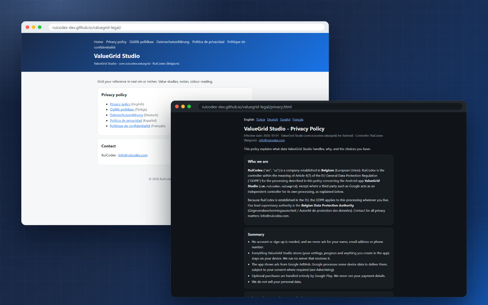
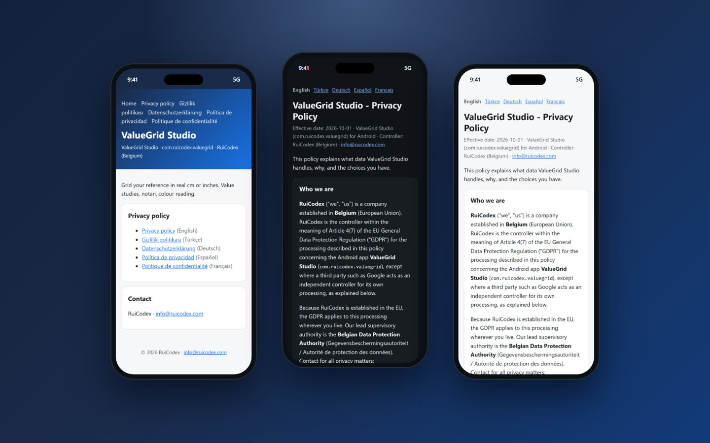
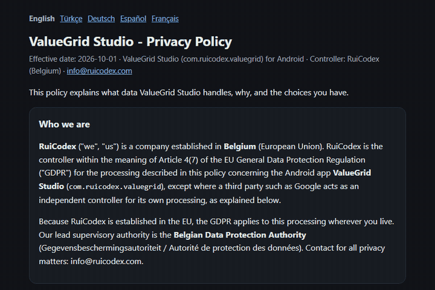
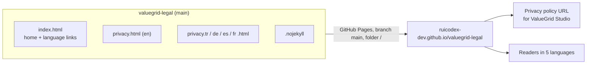
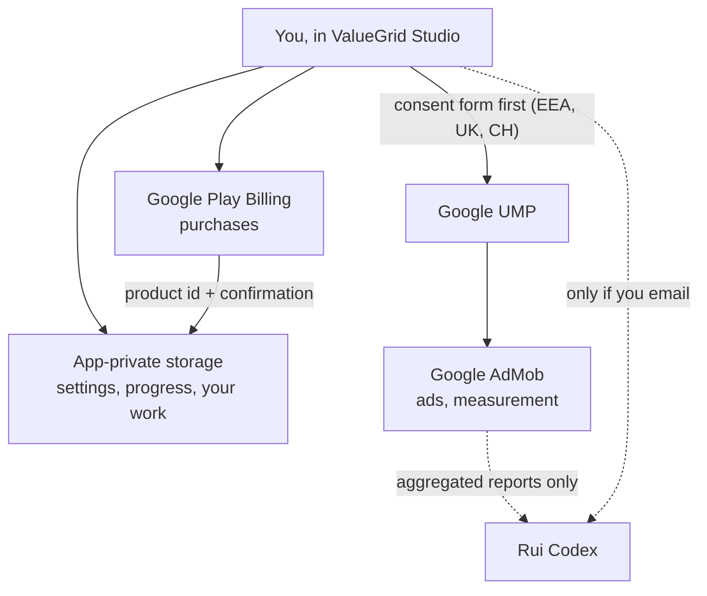

<div align="center">

<picture>
  
</picture>

### The public privacy policy for **ValueGrid Studio**, the Android app that grids your reference in real cm or inches.

<p>
  
  
  
  
  
  
  
  
</p>

**[Live site](https://ruicodex-dev.github.io/valuegrid-legal/)** ·
**[Privacy policy](https://ruicodex-dev.github.io/valuegrid-legal/privacy.html)** ·
**[Rui Codex](https://ruicodex.com)**

</div>

---

## What this is

This repository is the source of the small static website that hosts the legal pages of **ValueGrid Studio**
(`com.ruicodex.valuegrid`), an Android app for artists: grid your reference in real cm or inches, and work on value studies,
notan and colour reading. The site is served by GitHub Pages straight from the `main` branch, so the URL above stays stable
as the app's privacy policy address.

There is no build step, no JavaScript and no tracking: six hand-written HTML files with inline CSS that follow the reader's
light or dark system theme.

<table>
  <tr>
    <td width="33%" valign="top"><b>Five languages</b><br>English, Türkçe, Deutsch, Español and Français, each a complete policy with a language switcher.</td>
    <td width="33%" valign="top"><b>GDPR first</b><br>Written for an EU controller in Belgium, with KVKK (Türkiye), UK, Swiss and US state rights.</td>
    <td width="33%" valign="top"><b>Plain and honest</b><br>A one-screen summary up front: no account, data stays on the device, ads only with consent.</td>
  </tr>
  <tr>
    <td valign="top"><b>Light and dark</b><br>CSS custom properties switch with <code>prefers-color-scheme</code>.</td>
    <td valign="top"><b>Zero dependencies</b><br>No framework, no web fonts, no scripts, no cookies, no analytics on the site.</td>
    <td valign="top"><b>Mobile ready</b><br>A single 760 px reading column with a responsive viewport, readable on any phone.</td>
  </tr>
</table>

## The pages

<table>
  <tr>
    <td width="50%"></td>
    <td width="50%"></td>
  </tr>
  <tr>
    <td align="center"><sub>Desktop at 1440 px: home page (light) and privacy policy (dark)</sub></td>
    <td align="center"><sub>Mobile at 390 px: home, privacy (dark), privacy (light)</sub></td>
  </tr>
</table>

| Page | English | Türkçe | Deutsch | Español | Français |
| --- | --- | --- | --- | --- | --- |
| Home (all links) | [index.html](https://ruicodex-dev.github.io/valuegrid-legal/) | | | | |
| Privacy policy | [privacy.html](https://ruicodex-dev.github.io/valuegrid-legal/privacy.html) | [privacy.tr.html](https://ruicodex-dev.github.io/valuegrid-legal/privacy.tr.html) | [privacy.de.html](https://ruicodex-dev.github.io/valuegrid-legal/privacy.de.html) | [privacy.es.html](https://ruicodex-dev.github.io/valuegrid-legal/privacy.es.html) | [privacy.fr.html](https://ruicodex-dev.github.io/valuegrid-legal/privacy.fr.html) |

<div align="center">
  
  <br><sub>One policy, five languages. The translations are for convenience; the English version prevails unless mandatory law says otherwise.</sub>
</div>

## The policy at a glance

The privacy policy (effective **2026-10-01**) says, in short:

- **No account.** ValueGrid Studio never asks for a name, email address or phone number.
- **Your work stays on your device.** Settings, progress and anything created in the app live in Android's app-private storage.
  Rui Codex runs no server that receives it. Delete it with the app's reset option, *Clear storage* or by uninstalling.
- **Ads from Google AdMob, with consent.** Users in the EEA, the UK and Switzerland see Google's consent form (UMP, IAB TCF)
  before any ad is requested. Personalised ads need consent; the choice can be changed any time under *Privacy options* in settings.
- **Purchases through Google Play Billing.** Rui Codex never sees payment details; only the product id and purchase
  confirmation are kept on the device to unlock what was bought.
- **No analytics or crash reporting** run by Rui Codex, beyond aggregated AdMob reports.
- **Rights** under the GDPR, KVKK (Art. 11), UK GDPR, Swiss FADP and US state laws, answered within one month, free of charge.
  Lead supervisory authority: the Belgian Data Protection Authority.
- **Audience:** 13 and over. Ad content is limited to the "G" rating.
- **Law:** Belgian law and the GDPR, with consumer protections under Rome I and Brussels Ia, and free out-of-court mediation.

## How it works



What the policy describes, as a data flow:



## Tech stack

| Layer | Choice |
| --- | --- |
| Pages | Hand-written HTML5, one file per language |
| Styling | Inline CSS with custom properties, `prefers-color-scheme` light and dark |
| Fonts | System font stack (`system-ui`, `-apple-system`, `Segoe UI`, `Roboto`) |
| Hosting | GitHub Pages from `main` at `/`, with `.nojekyll` so files are served as is |
| Scripts, cookies, analytics | None |

## Getting started

Preview the site locally with any static file server:

```bash
git clone https://github.com/RuiCodex-dev/valuegrid-legal.git
cd valuegrid-legal
python -m http.server 8000
# open http://localhost:8000/
```

Opening `index.html` directly in a browser works too, since every link is relative.

<details>
<summary><b>Updating the policy</b></summary>

1. Edit `privacy.html` (English is the reference version) and change the effective date in the header line.
2. Apply the same change to `privacy.tr.html`, `privacy.de.html`, `privacy.es.html` and `privacy.fr.html` so all five versions
   stay in step.
3. If you add a page or a language, link it from the header and list in `index.html` and from the language bar of every
   privacy page (`hreflang` set).
4. Commit to `main`. GitHub Pages republishes within a minute or two, and the URLs stay the same, so nothing that links to
   them needs a new link.

</details>

## Project structure

```text
valuegrid-legal/
├── .nojekyll          # serve files as they are (no Jekyll processing)
├── index.html         # legal home: app name, package, links to every policy, contact
├── privacy.html       # privacy policy, English (reference version)
├── privacy.tr.html    # Türkçe
├── privacy.de.html    # Deutsch
├── privacy.es.html    # Español
├── privacy.fr.html    # Français
└── docs/media/        # README banner, badges and screenshots
```

## FAQ

<details>
<summary><b>Where do I send a privacy request?</b></summary>

Write to **info@ruicodex.com** with "Privacy – ValueGrid Studio" in the subject line. Requests are answered within one month,
free of charge.

</details>

<details>
<summary><b>Does the app upload my reference photos or drawings?</b></summary>

No. According to the policy, everything ValueGrid Studio stores stays in the app's private storage on your device, and Rui Codex
runs no server that receives it. Only the Google services described in the policy (AdMob, the consent platform and Play Billing)
process device data.

</details>

<details>
<summary><b>How do I change my ad consent?</b></summary>

Open *Privacy options* in the app's settings. You can also reset your advertising ID or opt out of personalised ads in Android
Settings > Google > Ads.

</details>

<details>
<summary><b>Which language version applies?</b></summary>

The English version is the reference. The translations are provided for convenience; if they differ, the English text prevails
unless mandatory law requires otherwise.

</details>

---

<div align="center">
<sub>
<b>License:</b> All rights reserved, © 2026 Rui Codex.<br>
Built by <a href="https://ruicodex.com">Rui Codex</a> in Belgium.<br>
<b>Media credits:</b> screenshots are real captures of the live site; banner and badges are hand-made SVG (the still life in the
banner is an illustration, not app UI). No generated imagery.
</sub>
</div>
